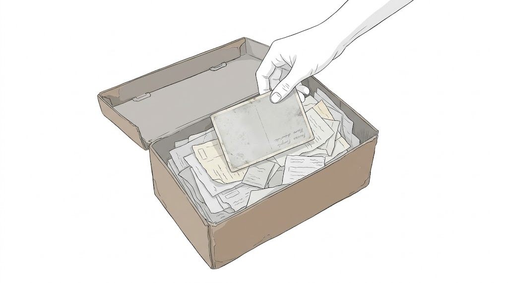

Sobre la mesa del comedor hay una caja de zapatos abierta. Dentro hay recibos de la luz con el papel ya del color del té, una carta de la comunidad sobre la derrama del ascensor y la factura de un fontanero que cobraba en pesetas y escribía con una letra que ya no se enseña. Debajo de todo hay una foto: un niño en un balcón, con los ojos entornados contra un sol de otro tiempo.

Todo esto, me explican, es prueba.

Nadie guardaba aquellos papeles para demostrar nada. Se guardaban por costumbre, por esa prudencia de la gente que vino de fuera y aprendió que en la ciudad todo se pide por escrito. Se guardaban como se guarda el pan duro: sin saber muy bien para qué, por si acaso.

El por si acaso ha llegado medio siglo después, con número de procedimiento.

Uno pasa más de cincuenta años en una casa y descubre, leyendo un escrito, que no ha vivido en ella. Ha poseído. De forma pública, pacífica e ininterrumpida, en concepto de dueño. Así lo dice el papel, con esa prosa de juzgado capaz de convertir una infancia entera en tres adverbios.

Tiene su gracia. Durante décadas nadie preguntó. El cartero sabía nuestro nombre, la vecina del tercero sabía a qué hora se encendía la luz de la cocina y el portero sabía quién llegaba tarde. La casa era nuestra del modo en que lo son las cosas que no se discuten: porque a nadie se le ocurría discutirlas.

Ahora hay que demostrarlo. Y no basta con haber estado. Hay que haber estado de una manera concreta, con una intención concreta, durante un tiempo que la ley mide con una precisión que la memoria no tiene.

La memoria mide de otra forma. Mide en Navidades, en gripes, en esperas. Mide en la noche en que alguien no volvía y en la mañana en que por fin volvió. Mide en el pasillo que de niño parecía larguísimo y que ahora se cruza en cuatro pasos.

Nada de eso cabe en una caja de zapatos. Y sin embargo es lo único que de verdad sucedió allí.

Del otro lado también hay papeles. Mejores, seguramente. Con sellos, con firmas que valen más que la mía, con esa autoridad tranquila de lo que está inscrito. **El notario da fe; nosotros solo la teníamos.** Y no es lo mismo, aunque se escriba igual.

Lo pienso sin rencor, o con el mínimo que me permito. Porque el pleito no es lo que más pesa. Lo que pesa es lo que uno tiene que decir en voz alta para ganarlo: las fechas que hay que recordar con exactitud y los nombres que hay que poner en un escrito, nombres que durante años se dijeron en la mesa, a la hora de comer, con otra voz.

Un juicio sobre una casa nunca es solo sobre una casa. Es sobre quién estuvo y quién no. Sobre quién subía la escalera cuando se rompía el ascensor y quién se acordó de ella cuando hubo algo que firmar. Pero eso tampoco consta. El derecho, con buen criterio, no entra en la cocina.

Vivimos en un tiempo que no se fía de nada que no esté registrado. Si no hay foto, no pasó. Si no hay recibo, no se pagó. Si no hay escritura, no es tuyo. Hemos llegado a creer que la realidad es lo que deja rastro en un documento, y que lo demás es una especie de rumor.

Y sin embargo lo más serio que hacemos en la vida no deja rastro. Cuidar no deja rastro. Esperar no deja rastro. Quedarse cuando irse habría sido más fácil no genera ningún recibo.

Hay una promesa antigua, mucho más vieja que cualquier código, que dice que la tierra será para los mansos. No habla de escrituras ni de plazos de prescripción.

Nunca he sabido si es una promesa o una advertencia. Quizá las dos cosas: que la tierra no se gana a empujones, pero que tampoco se pierde por no empujar.

Hay otra SENTENCIA, con mayúsculas, que conozco desde niño. En ella, el que estaba en el centro de la sala era el único inocente, y el que firmaba se lavaba las manos.

Me acuerdo de ella cada vez que alguien me dice que hay que confiar en la justicia. Confío. Pero sé desde pequeño que una sentencia y la verdad no siempre caminan juntas, y que a veces la verdad tiene que esperar a que pase el sábado.

Vuelvo a la caja. La factura del fontanero, la carta del ascensor, el niño del balcón. Alguien en un juzgado leerá estos papeles con atención profesional y decidirá si bastan.

Si dicen que sí, ¿será la casa más nuestra de lo que fue ayer? Y si dicen que no, ¿habremos dejado de haber vivido allí?

Guardo la foto la última, encima de todo. El niño sigue mirando al sol con los ojos entornados. No sabe nada de plazos. No sabe todavía que algún día tendrá que demostrar que estuvo.

Me pregunto qué tendría que haberle enseñado alguien a ese niño: a guardar los papeles o a no necesitarlos nunca. Todavía no sé cuál de las dos cosas es sabiduría y cuál es ingenuidad.
